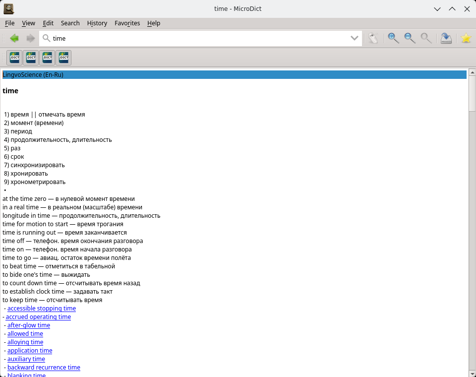

# MicroDict

A fully local dictionary for Linux. Simplified fork of the Goldendict-ng project.

- WebEngine was thrown away from it
- All the online dictionary functionality (Wikipedia etc) have followed the WebEngine
- Search is now using xapian 2 fuzzy search (FLAG_FUZZY) to deal with typos/misspells (computre→computer)
- Global hotkeys (the F12 one) work in wayland too, not just in x11
- It now uses the system color scheme and the accent color and able to changes it dynamically, following day/night Plasma theme auto switch



## Features

* Supports many dictionary formats, such as MDX, DSL, StarDict, XDXF, Slob, DictD,
  BGL, GLS, Aard, SDictionary — see [dictionary formats](website/docs/dictformats.md)
* Supports special types of "dictionaries", such as external programs, morphology,
  transliteration and audio files — see [sources management](website/docs/manage_sources.md)
* Built-in full-text search
* Supports user-submitted pronunciation recordings
* Follows the desktop's colours and its dark/light choice, including the accent
  colour, and switches together with the desktop without a restart
* On Linux: one fully static binary for x86-64 and aarch64 — no shared libraries,
  no interpreter, no bundled fonts

## Getting it

You can download Appimages for  `x86_64` and `aarch64` at the [Releases](https://github.com/dsvi/MicroDict/releases) section.

But arguably better way is just launching `user-install.sh`, if you have docker installed and your user is in the
`docker` group. It builds distro agnostic executable with no dependencies, inside a docker container (Alpine musl based) and installs for current user without the need of `sudo`. Just right click on the app icon to have submenu *Delete*
and *Delete with user data* when you dont need it anymore.

In essense it just puts these files:
```
  binary           ~/.local/bin/microdict
  uninstaller      ~/.local/bin/microdict-uninstall
  desktop entry    ~/.local/share/applications/io.github.dsvi.microdict.desktop
  icon             ~/.local/share/icons/hicolor/256x256/apps/microdict.png
```
And the uninstaller is called from the right click submenu to clean things up.

Nothing is installed, nothing is removed from the system.


## Building

```
./build-appimage.sh     # Alpine/musl, static; output in ./build-out:
                        # the binary and the AppImage
```

Everything else — CMake options, the Alpine recipe, the in-image checks — is in
`packaging/docker/README.md`; the dependency ledger is `DEPENDENCIES.md`.

## Bugs and discussion

* [Issue tracker](https://github.com/dsvi/MicroDict/issues)

## License

This project is licensed under the **GNU GPLv3+** license, a copy of which can be
found in `LICENSE.txt`.

## History and attribution

* Konstantin Isakov and the developers of the original program, from which this
  one descends.

