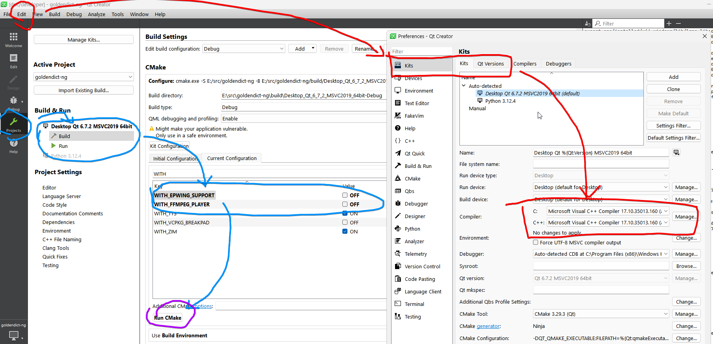

If you know some C++ and optionally some Qt, you can start to modify MicroDict
right now.

This page is a brief introduction on how to get started.

For technical details see [how to build from source](howto/build_from_source.md) and,
for the release build, [Build the static Linux binary](howto/build_static_linux.md).
The dependency ledger — what is linked, what was dropped and why — is
[`DEPENDENCIES.md`](https://github.com/dsvi/MicroDict/blob/main/DEPENDENCIES.md)
in the repository root.
## Install Qt

To install Qt on macOS, use the [Qt Online Installer](https://doc.qt.io/qt-6/get-and-install-qt.html). It can be downloaded from [Qt for Open Source](https://www.qt.io/download-open-source). On Linux, install your distribution's Qt 6 development packages — see [how to build from source](howto/build_from_source.md) for the list.

Those Qt components are needed:

+ Qt
    + 6.12 (Or another version)
        + Qt5 Compatible Module
        + Multimedia
        + SVG
        + Tools (for `lrelease`)
        + Wayland (Linux only — the platform plugin and the D-Bus portal client)
    + Qt Creator (optional)
        + CMake
        + Ninja

Not needed at all: Qt WebEngine, Qt WebChannel and Qt TextToSpeech.

CMake and Ninja are needed.

## Install a compiler

On Linux, Alpine's `build-base` (GCC 15 in this fork's image); any C++23 compiler
works. For macOS, install [XCode](https://developer.apple.com/xcode/).

## Obtain dependencies

On Linux they come from the distribution — except Xapian, which must be the 1.4
series, and the libraries the static image builds from source.

For macOS, install [Homebrew](https://brew.sh/) and install the packages the build
looks for: `cmake/Deps_macOS.cmake` lists every library name `pkg_check_modules`
resolves, and [how to build from source](howto/build_from_source.md) gives the
`brew install` spelling.

## Build

First, get MicroDict's source code by [Cloning a repository](https://docs.github.com/repositories/creating-and-managing-repositories/cloning-a-repository).

Then choose your favorite IDE/editor and load the `CMakeLists.txt`. If unsure, just use Qt Creator.

### Qt Creator

Open `CMakeLists.txt` from Qt Creator, then you wil choose a "Kit" which is pretty much a Qt installation.

Qt Creator usually can auto-detect your Qt installation. In case it doesn't, check out "Kit" settings.

By default everything is built; the only switch left is `WITH_QT_MULTIMEDIA`, the
one internal audio player. Upstream's `WITH_EPWING_SUPPORT`, `WITH_ZIM`, `WITH_TTS`,
`WITH_X11`, `WITH_FFMPEG_PLAYER` and `USE_ALTERNATIVE_NAME` do not exist here.



Then, hit the "Run" button at bottom-right corner should build and run MicroDict.

### Command Line only

See [how to build from source](howto/build_from_source.md).

[Qt's doc: Building projects on the command line](https://doc.qt.io/qt-6/cmake-build-on-cmdline.html)

### Visual Studio Code

Install [CMake Tools](https://marketplace.visualstudio.com/items?itemName=ms-vscode.cmake-tools).

Then open MicroDict's folder, and the CMake extension will kicks in.

Then add Qt's path and various other options to configure arguments.

```
-DCMAKE_PREFIX_PATH=<your Qt install path>
```

## Related Things

Please follow [C++ Core Guidelines](https://isocpp.github.io/CppCoreGuidelines/CppCoreGuidelines) and write modern C++ code.

[Qt's documentation](https://doc.qt.io/)
