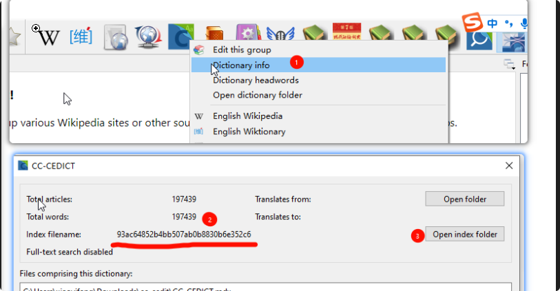
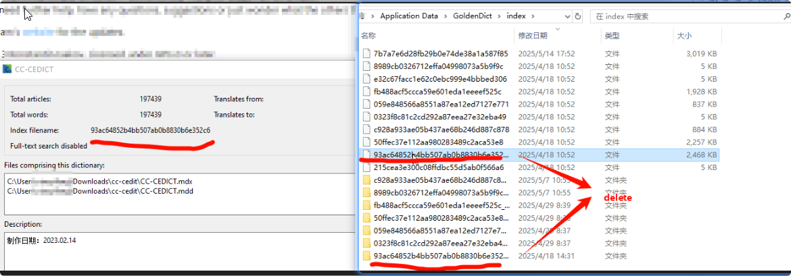

# Purpose

Sometimes you may want to reindex a dictionary by hand.

# Steps

1. Find out the index filename of the dictionary:
   You can find the index filename by right clicking on the dictionary in the dictionary bar.
   
2. Open the index folder: `$XDG_CACHE_HOME/microdict/index`, by default
   `~/.cache/microdict/index` — see
   [Configuration folders](../topic_config_folders.md)
3. Exit MicroDict.
4. Delete the dictionary's index file (& folder):
   
5. Reopen MicroDict:
   The dictionary will be reindexed.
