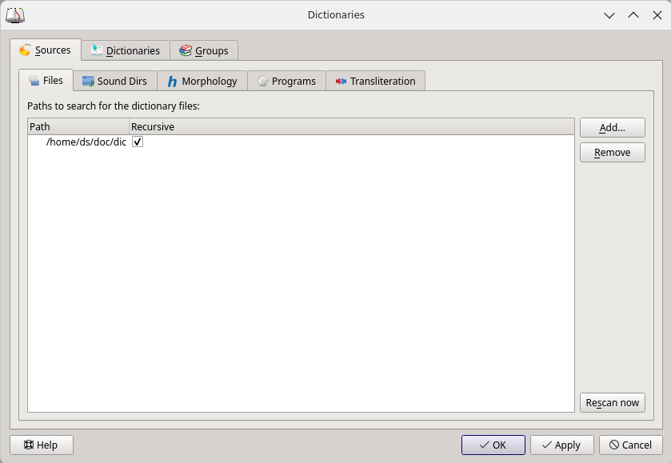

Dictionary management dialog can be opened via menu `Edit` -> `Dictionaries`.

To use local dictionaries, add them via `Sources` -> `Files`.

To inspect or disable individual dictionaries, go `Edit` -> `Dictionaries` -> `Dictionaries`.

If you have too many dictionaries, consider using `Groups` to manage them.

## Files

Here you can add local dictionaries.

Press the "Add" button and select folders that include your local dictionaries. To search every subfolder, enable the "Recursive":

MicroDict will scan these folders and add found dictionaries to the dictionaries list.

The "Rescan" button starts a forced scan of all folders in the list.

## Sound Dirs

Similar to Files, you can either add a folder which contains sound files or a `.zip` archive which contains the sound files.

MicroDict will search through the sound file names when querying words.

## Morphology

A word could have several forms, but sometimes a dictionary only contains one form that could not be found unless you search the normalized form.

Morphology dictionary uses Hunspell's morphological analysis to obtain word's variant forms.

You can specify a path that includes Hunspell format data files (`.aff` + `.dic`). MicroDict will scan this folder and create a list of available dictionaries.

One possible source of Hunspell dictionaries is LibreOffice's [dictionaries](https://github.com/LibreOffice/dictionaries).

The detailed document about the affix file (`.aff`) and the dict file (`.dic`) can be found at [hunspell.5](https://man.archlinux.org/man/hunspell.5.en).

Note that lots of Hunspell's dictionaries are for mostly for spell checking, and they may lack special morphological rules (For example, related words don't share the same stem in `.dic` file).
There are some specially tailored hunspell dicts to use for Morphology. Such as

* <https://github.com/Ajatt-Tools/hunspell-ja>

## Programs

Here you can add external applications. To add such an application, you should set the command line for its launch, name for the dictionary list and application type.

The `%GDWORD%` in command line will be replaced by word from search line.

| Program type | Purpose                                                                               |
|--------------|---------------------------------------------------------------------------------------|
| Audio        | Play sound.                                                                           |
| Text         | Text printed by the program will be shown as separate article.                        |
| HTML         | HTML printed by the program will be shown as separate article.                        |
| Prefix match | A list of words printed by the program will be added to search bar's completion list. |

Other than "Audio", the program should print the content to standard output.

In the "Icon" column, you can set a custom icon for every application. If you add icon file name without a path, MicroDict will search this file in the configuration folder.

!!!note 

    The word will be written to `stdin` in UTF-8 if the command line doesn't contain `%GDWORD%`.

    For Python3.6+, reading `stdin` as UTF-8 is the default behaviour. For older versions, you may need to change [PYTHONIOENCODING](https://docs.python.org/3/using/cmdline.html#envvar-PYTHONIOENCODING).

    For Node.js, try `process.stdin.setEncoding('utf8');`.

    If you cannot change how your language handles stdin's encoding, try store the data read from the `stdin` as bytes and call related methods that interpret bytes as UTF-8 strings.

## Transliteration

Here you can add transliteration algorithms. To add an algorithm to the dictionaries list, just set a mark beside it. When such a dictionary is added to the current dictionaries group, MicroDict will search for the word in the input line as well as the result of its handling by the corresponding transliteration algorithm.

### Chinese and Japanese character conversion

MicroDict ships with a built-in conversion

| Option | Effect |
|--------|--------|
| Simplified (Mainland) | Traditional Chinese and Japanese Shinjitai input is also searched as simplified Chinese. |
| Traditional (Taiwan/Standard) | Simplified Chinese and Japanese Shinjitai input is also searched as traditional Chinese (Taiwan standard). |
| Hong Kong variant | Simplified Chinese and Japanese Shinjitai input is also searched as traditional Chinese (Hong Kong variant). |
| Japanese Shinjitai | Simplified and traditional Chinese input is also searched as Japanese Shinjitai. |

Every ticked option is registered as a separate dictionary in the list below, so it can be enabled per dictionary group. The word can be typed in any of the variants and still match the entries, for example searching `図書館` also finds `圖書館` and `图书馆`.

The conversion data is provided by [OpenCC](https://github.com/BYVoid/OpenCC); see [Customize the opencc](<howto/how to customize the opencc.md>) for the configuration files in use. If you want to define your own transliteration rules, see [Custom transliteration](topic_transliteration.md).

## What is not here

Upstream's `Websites`, `DICT servers` and `System Text-to-speech engines` tabs are
gone: they needed the network stack or the web engine. A website dictionary can still
be approximated with a `Programs` entry that fetches the page itself and prints HTML,
but nothing in this fork runs the page's scripts — see
[Article rendering](article_rendering.md).
